# Лабораторная работа №1. Эксплуатация MongoDB

## Цель работы
Развернуть MongoDB на виртуальной машине без использования Docker и освоить её настройку, управление пользователями, резервное копирование и мониторинг с помощью скриптов.

### Окружение
- Виртуальная машина: Oracle VirtualBox
- Операционная система: Lubuntu 24.04 LTS
- Рабочий компьютер: Windows 10
- Способ управления: Терминал  внутри виртуальной машины

## 1. Базовая настройка

Работа началась с подготовки операционной системы. В связи с техническими обстоятельствами, после нескольких безуспешных попыток подружиться с Ubuntu пришлось сдаться и перейти к настроийке Lubuntu. Были обновлены индексы пакетов и установлена утилита git для синхронизации с репозиторием.

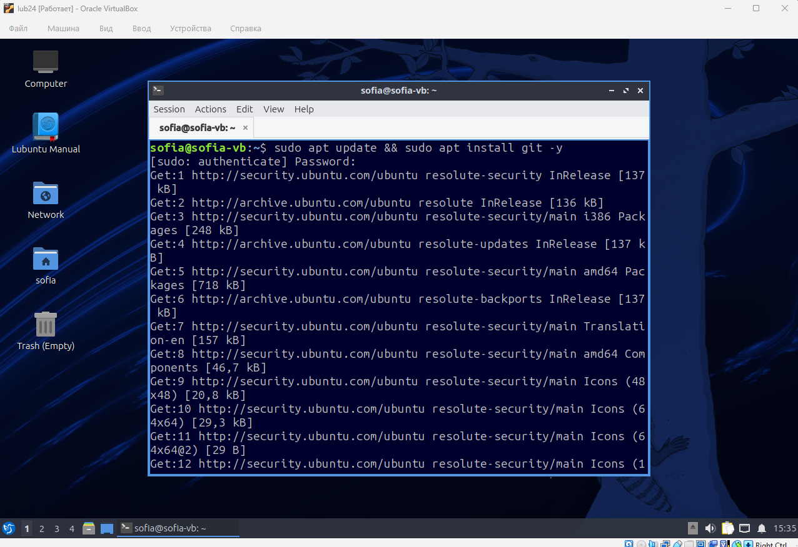

Для автоматизации установки MongoDB 7.0 использовался заранее подготовленный скрипт install_mongodb.sh. Перед запуском скриптам были выданы права на исполнение.

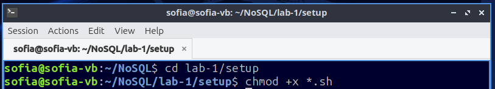

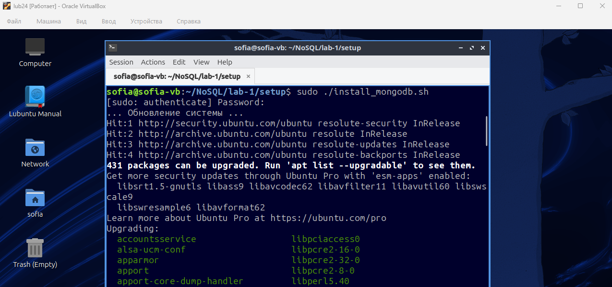

Скрипт автоматически добавил официальные ключи MongoDB и настроил репозиторий для Ubuntu Jammy (совместимый с текущей версией ОС).

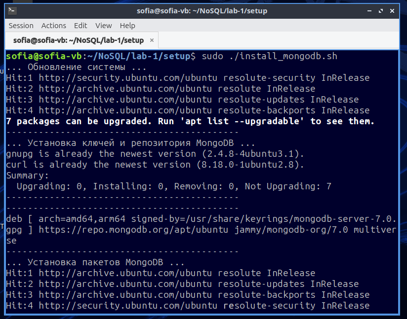

После завершения установки скрипт выполнил команду `systemctl enable mongod`, обеспечив автоматический запуск базы данных при загрузке виртуальной машины. Проверка статуса подтвердила, что сервер активен (active (running)).

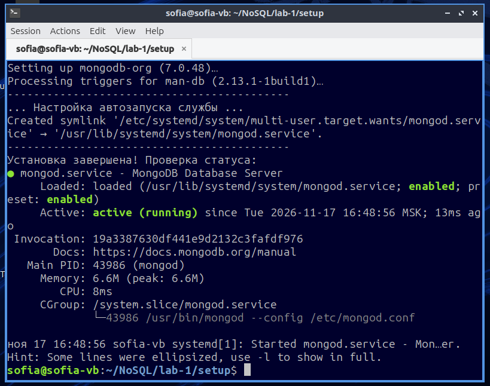

Для выполнения основных операций по сопровождению (запуск, остановка, перезапуск) был протестирован скрипт `mongodb_service.sh`. На скриншоте продемонстрирована последовательная остановка и запуск службы с последующей проверкой статуса.

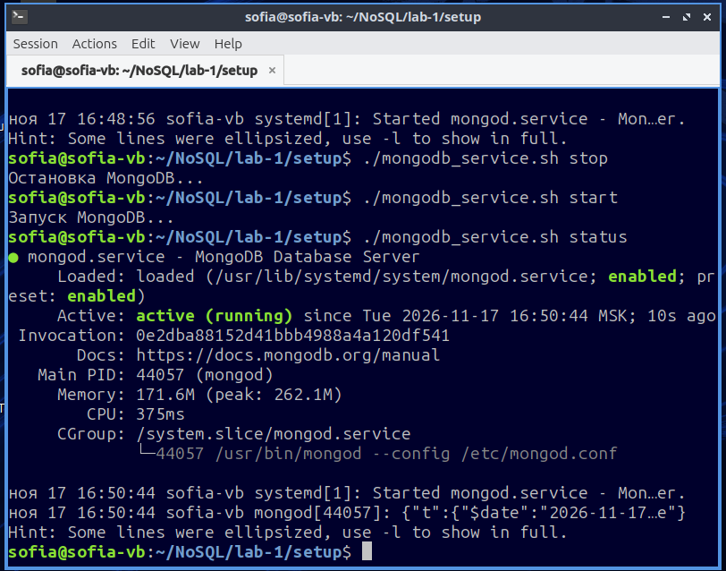

## 2. Управление ролевой моделью

Для защиты данных в конфигурационном файле `/etc/mongod.conf` был активирован параметр `authorization: enabled` в секции `security`. Это перевело базу данных из открытого режима в режим проверки прав доступа.

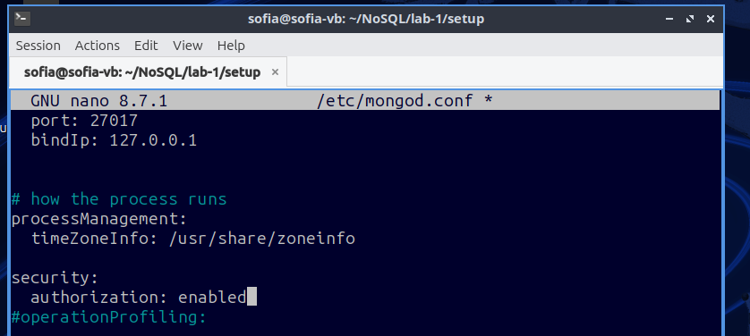

Первым шагом в защищенной системе стало создание суперпользователя `adminSofia`. Пользователю назначена роль `root` в базе `admin`, что дает полные права на управление всем экземпляром MongoDB.

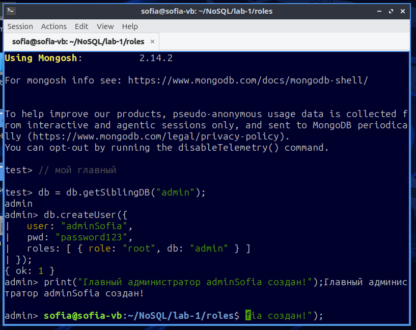

После создания учетной записи суперпользователя `adminSofia` была настроена ролевая модель доступа для разграничения привилегий между пользователями и изоляции баз данных.

Создание пользователей и тестовых баз (create_users.js):
- Созданы изолированные базы данных edu_db1 и edu_db2.
- Сформированы пользователи с базовыми ролями чтения и записи (readWrite) строго в рамках выделенных им пространств имен.

Создание кастомной роли (create_roles.js):
- Для реализации принципа наименьших привилегий (Principle of Least Privilege) создана специализированная роль productReader.
- Права роли ограничены исключительно действием find на коллекцию products, что запрещает пользователю модифицировать данные или обращаться к другим коллекциям.

Запуск скриптов производился из командной оболочки с авторизацией от имени суперпользователя.

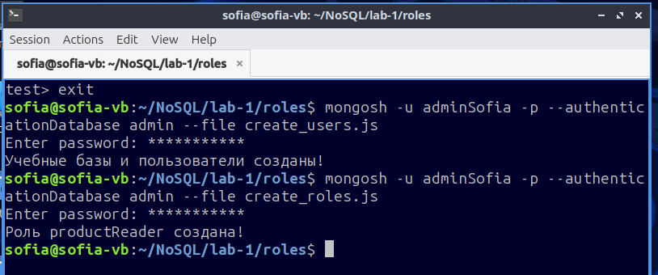

Для практической проверки изоляции данных были разработаны два скрипта:
1. `setup_access_test.js` — инициализирует в базе `edu_db1` конфиденциальную коллекцию `restricted_info`.
2. `test_collection_access.js` — пытается выполнить операцию чтения разрешенной коллекции `products` и защищенной коллекции `restricted_info` от имени непривилегированного пользователя.

При первичном запуске верификации скрипт зафиксировал уязвимость: доступ к закрытой коллекции `restricted_info` был неожиданно разрешен, из-за чего проверка безопасности завершилась провалом.

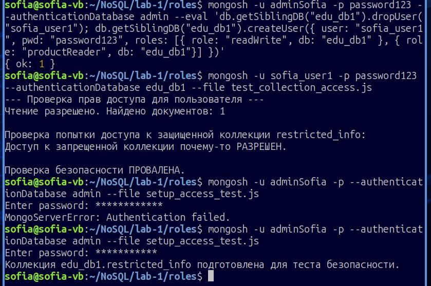

Оказывается, в MongoDB права доступа суммируются. Пользователю `sofia_user1` изначально были назначены две роли одновременно: одна, дающая полный доступ ко всем коллекциям базы, и вторая, ограничивающая чтение. Встроенная роль перекрыла ограничения кастомной, нарушив принцип наименьших привилегий (Principle of Least Privilege). Для устранения избыточных прав профиль пользователя был модифицирован от имени администратора. Встроенная роль `readWrite` была отозвана, а пользователю была оставлена исключительно  роль `productReader`.

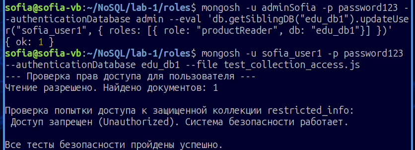

## 3. Резервное копирование и восстановление данных (Backup & Restore)

Для обеспечения сохранности данных разработаны скрипты автоматизации утилиты `mongodump`, использующие сжатие архивов и динамическую генерацию путей с временными метками.

Одиночный бэкап (backup_db.sh):
- Выполняет дамп указанной базы данных (edu_db1) в сжатый gzip-архив с сохранением метаданных и индексов.

Комплексный бэкап (backup_all_dbs.sh):
- Последовательно архивирует все пользовательские базы данных (edu_db1, edu_db2) в отдельный каталог сессии.

Проверка целостности каталога:
- С помощью команды ls -R ~/mongodb_backups подтверждено корректное создание структуры папок и бинарных архивов .archive.gz.

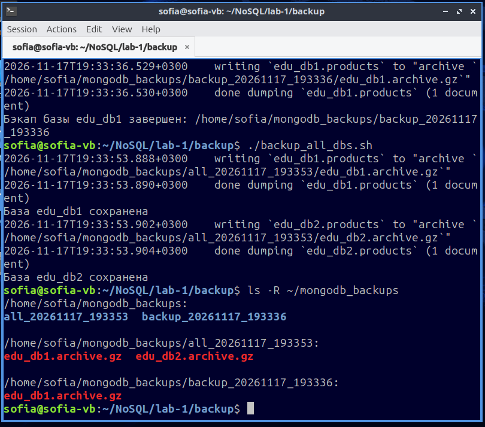

## 4. Настройка мониторинга и анализ метрик (Prometheus + Grafana)

Для непрерывного мониторинга производительности и состояния СУБД развернут стек:

- Percona MongoDB Exporter  — агент сбора внутренних метрик сервера.
- Prometheus TSDB — система сбора и хранения временных рядов.
- Grafana — платформа визуализации.

После запуска сервиса grafana-server выполнен вход в панель администрирования через браузер по адресу http://localhost:3000/login, где в качестве источника данных был подключен Prometheus.

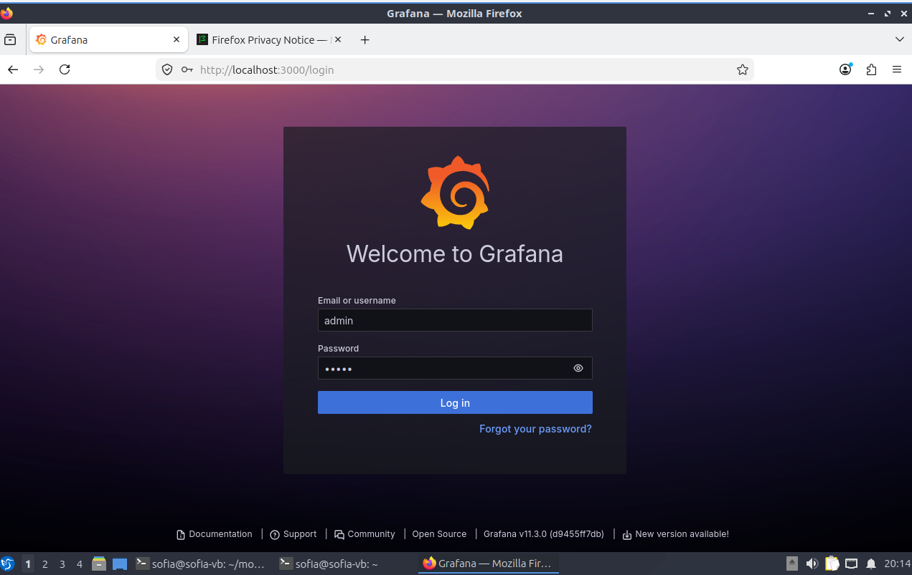

Для контроля работоспособности процесса mongod настроена панель с базовой метрикой `mongodb_up`. PromQL-запрос: `mongodb_up`

Значение метрики строго равно 1, что указывает на постоянную доступность базы данных и корректную сетевую связность между экспортером и СУБД.

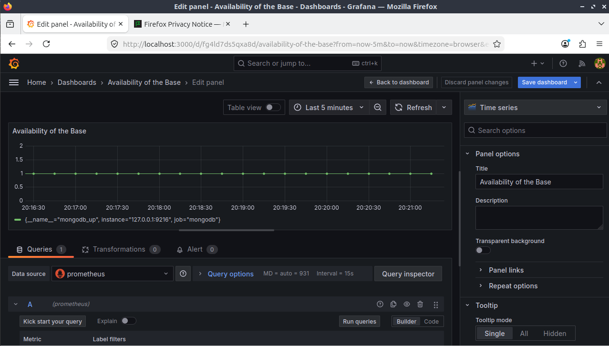

Для валидации работы мониторинга в реальных условиях был разработан скрипт `load_test.js`, выполняющий циклическую пакетную вставку 100 000 документов в коллекцию `load_collection`. PromQL-запрос: `mongodb_ss_connections{conn_type="current"}`

До начала теста зафиксирован базовый уровень соединений: 3 активных сессии (системные процессы и экспортер).
В момент запуска скрипта генерации (около 12:01) произошел резкий всплеск до 8 одновременных соединений, что отражает выделение пула воркеров для обработки транзакций. 
По завершении записи 100 000 документов метрика мгновенно вернулась к фоновому значению (3), что свидетельствует об отсутствии утечки соединений.

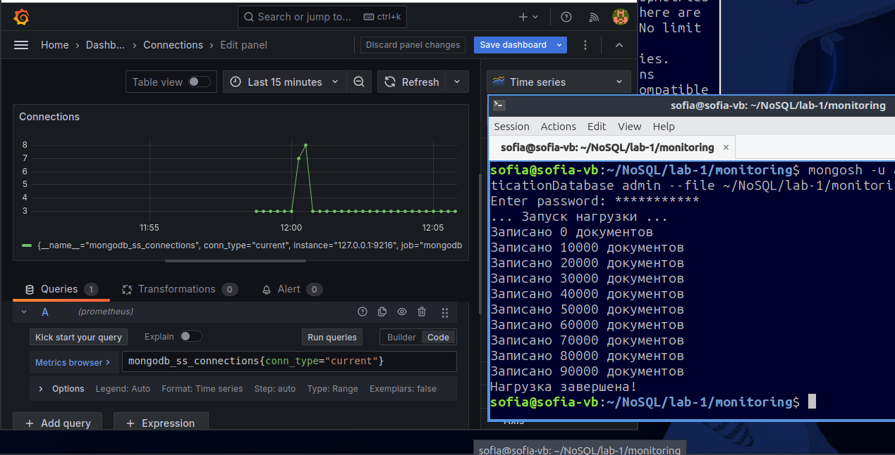

Панель отслеживает скорость выполнения различных типов операций СУБД в секунду. PromQL-запрос: `rate(mongodb_ss_opcounters[1m])`

Зеленая линия отображает стабильный уровень системных и служебных команд сервера.   Желтая линия фиксирует локальные всплески активности операций очистки коллекций перед тестами, что позволяет отслеживать аномальную активность записи/удаления.

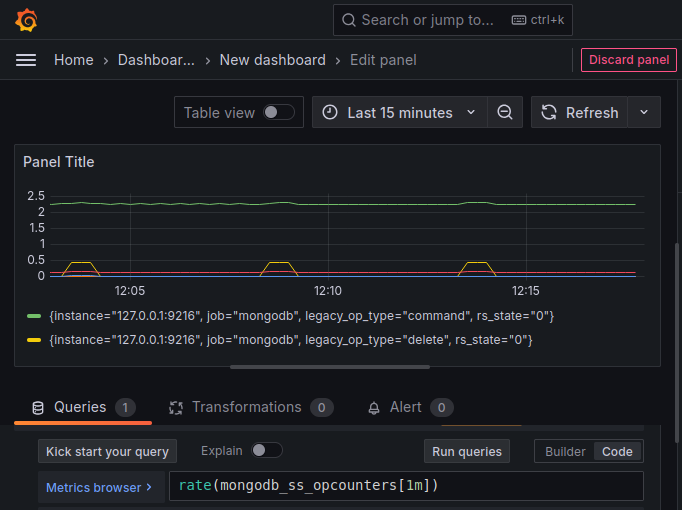

Помследняя метрика отражает объем физической оперативной памяти (RAM в мегабайтах), фактически занятой процессом mongod. PromQL-запрос: `mongodb_ss_mem_resident`

До старта нагрузки процесс потреблял стабильные ~218МБ оперативной памяти. В момент вставки 100 000 документов произошел скачкообразный рост потребления до ~224МБ. Данное поведение обусловлено выделением памяти и буферизацией входящих документов. После завершения нагрузки память осталась зарезервированной под кэш страниц, что является нормальным поведением.

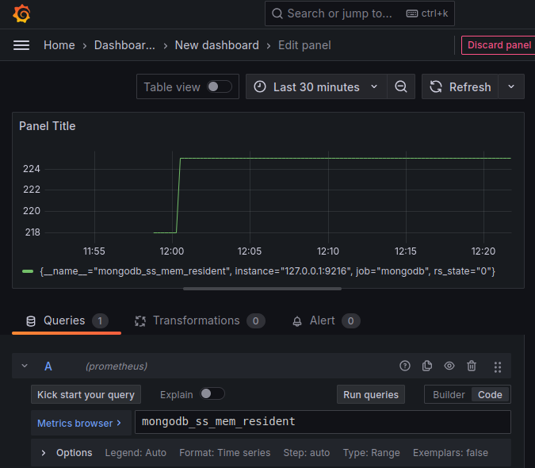

## 5. Заключение

В ходе выполнения лабораторной работы был развернут, сконфигурирован и всесторонне протестирован экземпляр документоориентированной СУБД MongoDB 7.0 в среде Linux без использования контейнеризации.

### Было ьбы удивительно, если бы за время выполнения не возникло трудностей. С чем я столкнулась:
1. **Проблемы с виртуализацией и графической оболочкой:**  
   Первоначальная попытка развертывания на дистрибутиве Ubuntu Desktop приводила к зависаниям среды VirtualBox. Система загружала черный экран и не реагировала Проблема была решена переходом на легковесный дистрибутив Lubuntu 24.04 LTS, что обеспечило высокую стабильность и низкое потребление ресурсов хоста.
2. **Ограничения прав экспортера метрик:**  
   При настройке связки Prometheus и `mongodb_exporter` метрики производительности базы не собирались из-за отсутствия системных привилегий у учетной записи мониторинга. Проблема решена делегированием администратору ролей `clusterMonitor` и `readAnyDatabase`, а также использованием флага `--collect.all`.
3. **Коллизия наследования привилегий:**  
   Пользователь имел доступ к конфиденциальным данным из-за одновременного наличия роли `readWrite` и кастомной роли. Ситуация была диагностирована с помощью автоматизированного тест-скрипта и решена сужением прав до минимально необходимых.

### Приобретенные навыки:
* Администрирование сервисов systemd в Linux: настройка автозапуска, управление процессами, написание скриптов для проверки.
* Построение системы безопасности БД: создание суперпользователей, пользовательских ролей с привилегиями на уровне коллекций.
* Автоматизация регламентных процедур резервного копирования со сжатием и генерацией динамических временных меток.
* Построение комплексного контура наблюдаемости: сбор метрик через Exporter, их агрегация в Prometheus TSDB и создание аналитических дашбордов в Grafana.
* Проведение стресс-тестирования СУБД и анализ поведения ключевых метрик (активные соединения, пул памяти WiredTiger, OpCounters) под нагрузкой.
