# Лабораторноя работа №2. Эксплуатация Opensearch 3.8

* **Окружение:** Lubuntu 24.04 LTS (x86_64), Docker Compose, OpenSearch 2.19.6

---

## 1. Цель работы

Развертывание production-ready распределенного поисково-аналитического кластера OpenSearch согласно архитектурными требованиями:
1. **Топология Hot-Warm:** Разделение узлов по ролям (Cluster Manager, Data Hot, Data Warm).
2. **Комплексная безопасность:** Настройка двухуровневого TLS-шифрования и ролевой модели доступа.
3. **Потоковый сбор данных и ISM:** Поставка JSON-логов Nginx через агент Fluent Bit в Data Stream и автоматизация управления индексами.
4. **Наблюдаемость (Observability):** Сбор метрик через OpenSearch Prometheus Exporter, агрегация в Prometheus и визуализация состояния кластера в Grafana.


---

## 2. Схема контейнеров и распределение ролей

| Контейнер | Роль в кластере | Атрибуты / Порты | Описание |
| :--- | :--- | :--- | :--- |
| `sofia-os-manager` | `cluster_manager` | Внутренняя сеть (9300) | Координация состояния кластера, кворум |
| `sofia-os-hot` | `data`, `ingest` | `temp: hot`, `9200:9200` | Первичная запись (Ingestion), индексация |
| `sofia-os-warm` | `data` | `temp: warm` | Хранение архивных индексов только для чтения |
| `sofia-os-dashboards` | UI Visualizer | `5601:5601` | Веб-интерфейс аналитики |
| `sofia-fluent-bit` | Log Shipper | Интеграция с Nginx | Парсинг и отправка JSON-логов по HTTPS |
| `sofia-nginx` | Web Server | `8088:80` | Генератор входящих access-логов |
| `sofia-prometheus` | Time-Series DB | `9091:9090` | Сбор метрик производительности узлов |
| `sofia-grafana` | Metrics Dashboard | `3002:3000` | Аналитические панели мониторинга |

Развернутая архитектура: 

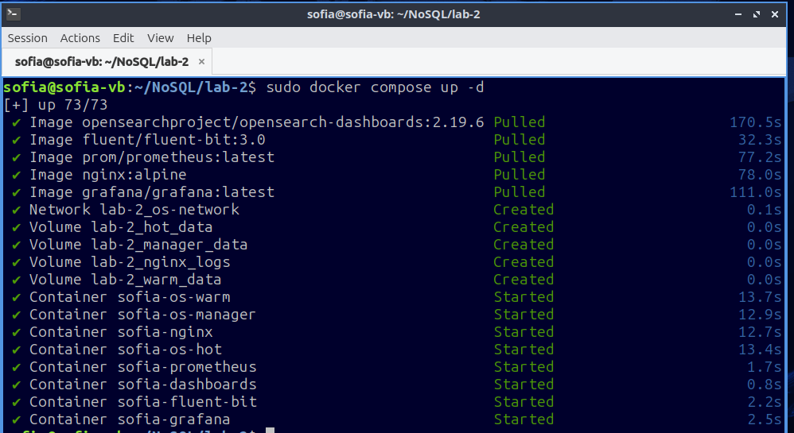

Выполняем запрос к API каталогов: `_cat/nodes?v` под учетной записью администратора.

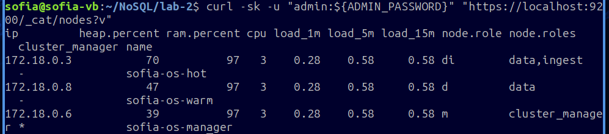

## 3. Практическая реализация

Предварительная подготовка хостовой системы Lubuntu перед запуском кластера OpenSearch. Проверка готовности среды виртуализации, системного параметра ядра Linux и структуры директории сертификатов.

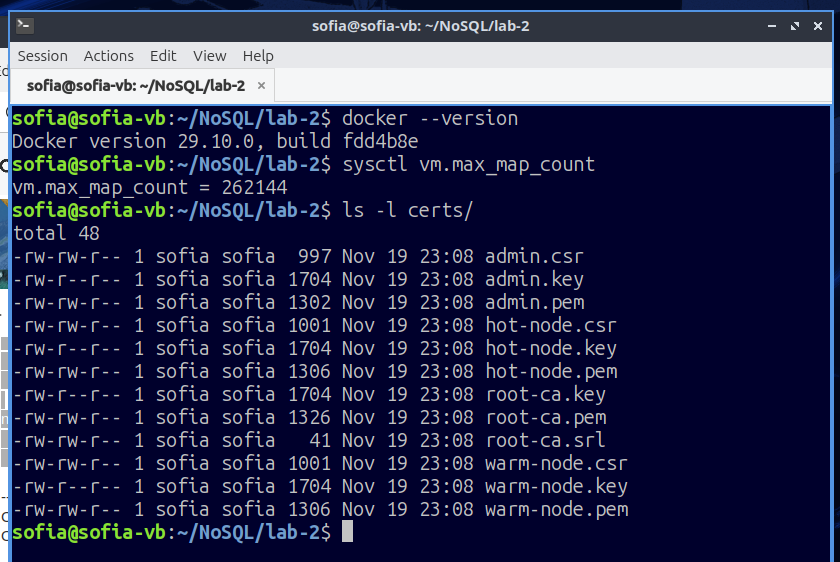

Наличие атрибута `temp: hot` сообщает планировщику шардов OpenSearch, что данный узел относится к быстрому слою (Hot tier), куда разрешено направлять первичную запись новых индексов согласно правилу `index.routing.allocation.require.temp = hot`

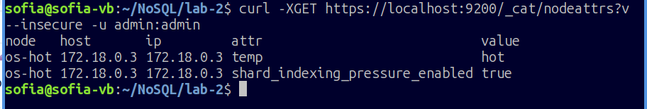

Для обеспечения безопасного межсерверного взаимодействия (Transport Layer) и внешнего REST API были выпущены сертификаты на базе собственного доверенного центра сертификации (Root CA).

* **Корневой CA:** `root-ca.pem`
* **Узловой сертификат:** Единый сертификат `node.pem` с расширением SAN (`subjectAltName = DNS:sofia-os-manager, DNS:sofia-os-hot, DNS:sofia-os-warm, IP:127.0.0.1`), исключающий ошибки hostname mismatch при рукопожатиях.
* **Административный сертификат:** `admin.pem` с DN `CN=A,OU=SofiaEdu,O=SofiaEdu,ST=SPB,C=RU` для аутентификации в Security API.

Генерация выполнена автоматизированным скриптом `generate-certs.sh`:

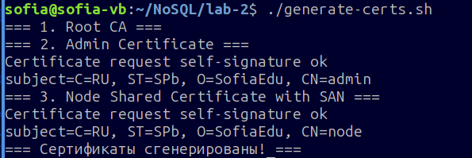

Через внутренний модуль безопасности OpenSearch были настроены роли и закреплены пользователи. У пользователя `sofia_writer` нет права на чтение, что гарантирует изоляцию потока записи.

Был создан композитный шаблон индекса `logs_template`, направляющий все новые шарды Data Stream `logs` на узлы с атрибутом `temp: hot`. Весь входящий поток данных изолирован на Hot-ноде и не попадает на архивный Warm-узел при первичной записи.

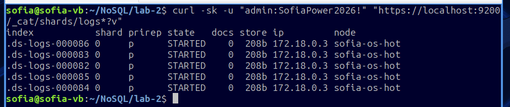

Жизненный цикл индексов регулируется автоматической политикой ISM:

Состояние Hot: новые данные поступают на sofia-os-hot. При достижении возраста 1 минута срабатывает операция rollover.
Переход в Warm: индекс переводится в режим read_only, после чего применяется директива маршрутизации:

```{ "allocation": { "require": { "temp": "warm" } } }```

Шард физически мигрирует на узел sofia-os-warm.
По истечении 10 минут с момента создания индекс удаляется действием delete.


## 4. Мониторинг и визуализация (Prometheus & Grafana)

Выполняем настройку Docker-образов для узлов кластера

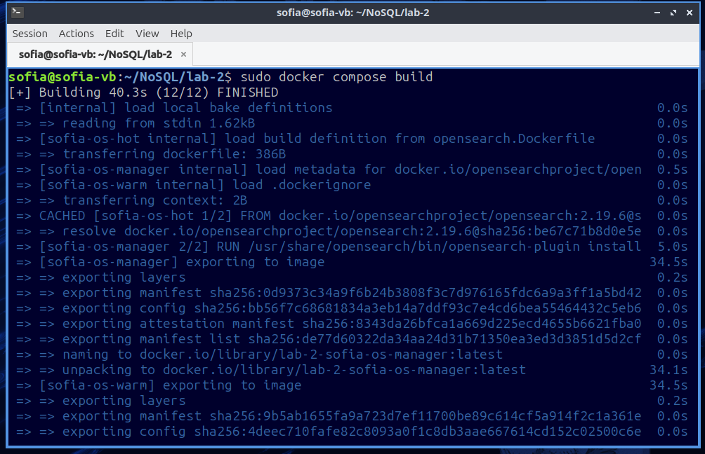

Для отслеживания производительности на узлы OpenSearch был установлен плагин prometheus-exporter (порт 9200/_prometheus/metrics).
Prometheus выполняет опрос метрик с аутентификацией под пользователем sofia_monitor.

В Grafana развернут кастомный дашборд, включающий три ключевые панели:

Cluster Status (Stat Panel): Запрос opensearch_cluster_status. Отображает текущее здоровье кластера (Green = 0, Yellow = 1, Red = 2).
CPU Utilization (Time Series): Запрос opensearch_os_cpu_percent. Динамика нагрузки на процессоры нод кластера.
JVM Heap Usage (Time Series / Gauge): Запрос opensearch_jvm_mem_heap_used_percent. Заполнение выделенной Java-памяти в процентах.

## 5. Проблемы, возникшие в процессе работы, и их решение
В ходе выполнения лабораторной работы возник ряд ситуаций, которые были последовательно локализованы и решены.

1. Сбой Transport Handshake при разных сертификатах нод

Ноды sofia-os-hot и sofia-os-warm не могли подключиться к sofia-os-manager. В логах фиксировались ошибки SSL: General SSLEngine problem / bad certificate.
Изначально для каждого контейнера генерировался изолированный сертификат с жестким DN, из-за чего проверка plugins.security.ssl.transport.truststore завершалась сбоем, поэтому пришлось перевыпускать сертификаты. Был применен архитектурный паттерн с общим сертификатом нод (node.pem), в который через Subject Alternative Names были включены имена всех хостов кластера (sofia-os-manager, sofia-os-hot, sofia-os-warm, localhost, 127.0.0.1).

2. Переполнение дискового пространства ("No space left on device")

Тут все тривиально. Для решения проводилась очистка неиспользуемых ресурсов Docker

3. Неприменение пароля администратора через переменные окружения

При попытке выполнения запросов под admin:SofiaPower2026! кластер возвращал 401 Unauthorized. Переменная OPENSEARCH_INITIAL_ADMIN_PASSWORD игнорировалась из-за того, что в кастомном opensearch.yml был отключен демонстрационный режим конфигурации (plugins.security.allow_default_init_securityindex: false), поэтому инициализатор пароля при первом запуске не отрабатывал. Пришлось обновить пароль учетной записи admin напрямую через внутренний REST API модуля безопасности с использованием TLS-сертификата администратора (admin.pem и admin-key.pem), имеющего наивысшие привилегии:

4. Ошибка валидатора парольной политики OpenSearch

API отклоняло установку пароля SofiaAdmin2026!. Оказывается, что встроенный анализатор сложности password_rules блокирует пароли, которые содержат имя учетной записи ("admin") в любой комбинации регистров.

5. Ошибка Prometheus Exporter (HTTP 500 / 403 Forbidden)

Prometheus фиксировал статус цели DOWN, а в логах скрапинга выводилась ошибка HTTP 500 Internal Server Error из-за того, что роли metrics_monitor не хватало гранулярных прав на сбор статистики по индексам, поэтому в определение роли metrics_monitor были добавлены кластерные действия после чего метрики успешно перешли в состояние UP.

6. Отсутствие физической миграции шардов на Warm-узел

Индексы нарезались по ISM, переходили в статус read_only, но оставались на ноде sofia-os-hot, потому что в исходном JSON-описании политики logs_policy в секции состояния warm отсутствовало действие allocation. Пришлось обновить политику через вызов PUT /_plugins/_ism/policies/logs_policy с внедрением блока. После применения обновления индексы перешли в фазу "name": "warm", а шарды были перераспределены на узел sofia-os-warm.

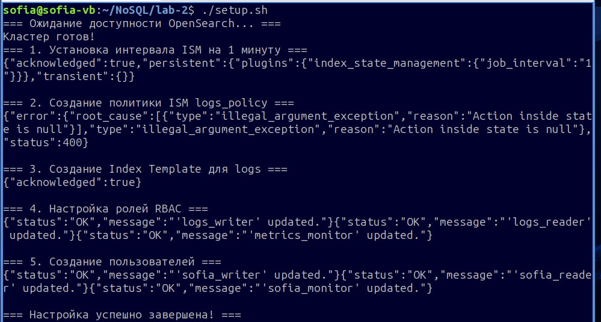

## 6. Валидация 

Разграничение доступа (RBAC: Отказ в чтении для Writer). Запрос отправляется от имени технического пользователя sofia_writer, созданного исключительно для поставки логов (агентом Fluent Bit), а кластер возвращает статус HTTP 403 Forbidden с исключением `security_exception`

Тот же самый запрос на поиск `_search?pretty&size=1` отправляется от имени пользователя `sofia_reader` (Reader_Sofia2026!) и в результате успешный ответ HTTP 200 OK.

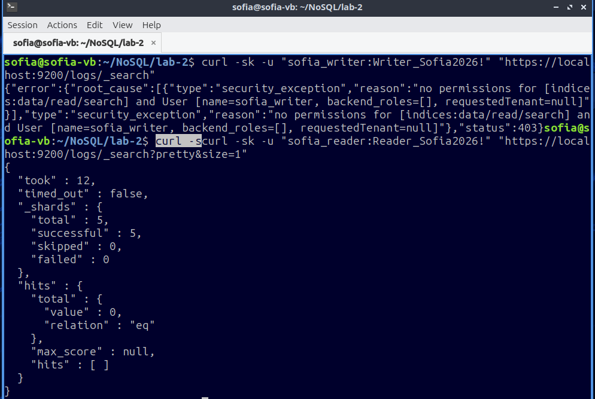


Проверка состояния индекса Data Stream через ISM API. В блоке state зафиксировано "name": "warm", подтверждающее успешный перенос и применение настроек политики.

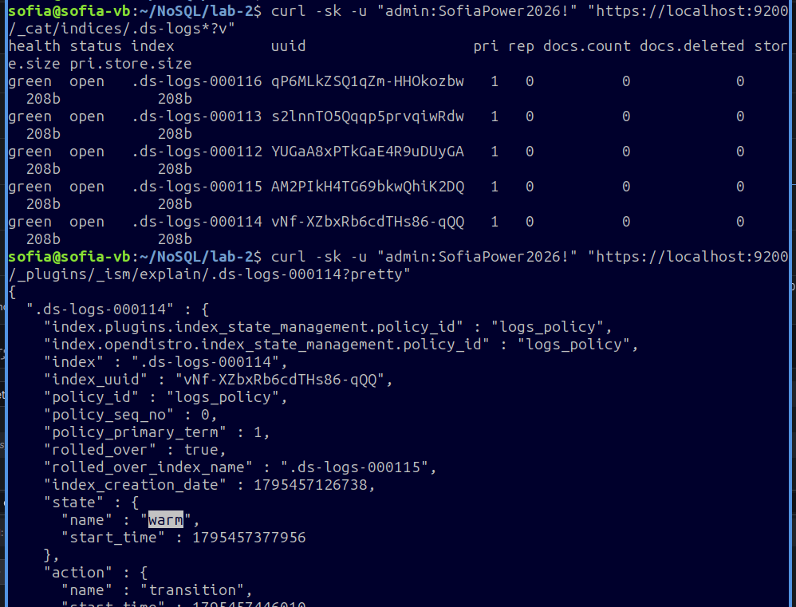


Мониторинг производительности кластера с помощью Grafana Dashboard. Панели отображают статус кластера, утилизацию CPU и распределение памяти JVM по узлам sofia-os-manager, sofia-os-hot, sofia-os-warm.

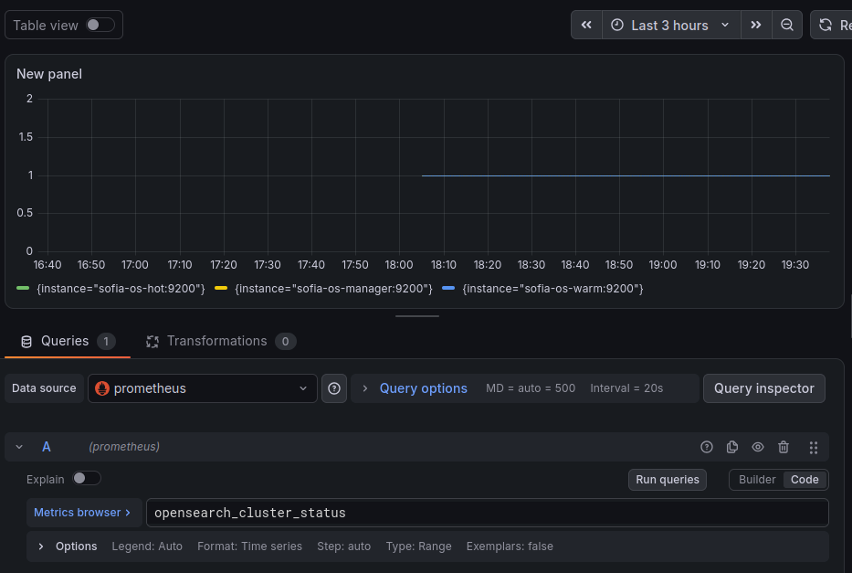

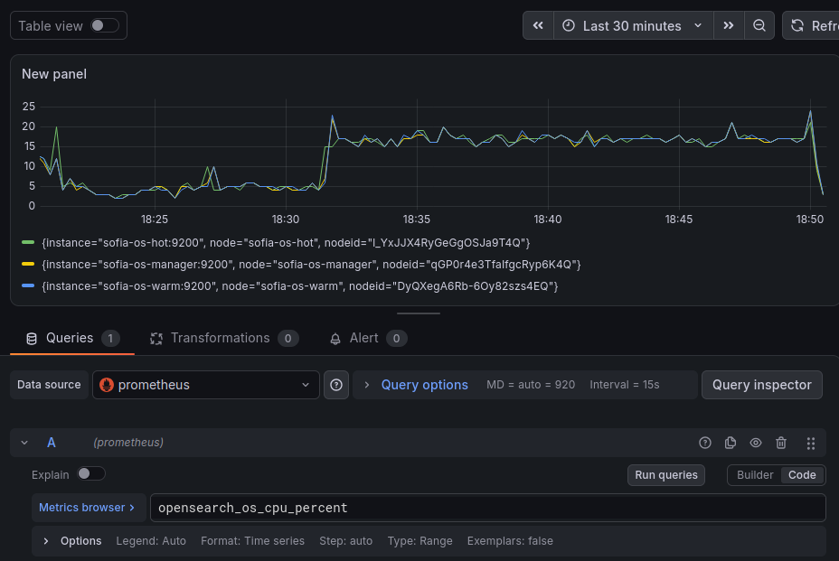

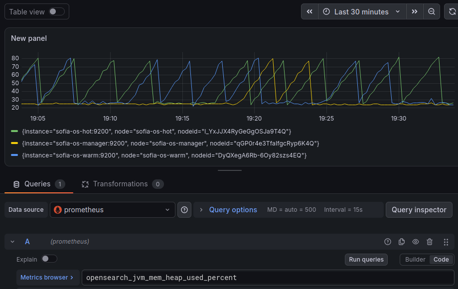


## Вывод
В ходе лабораторной работы была полностью спроектирована и развернута отказоустойчивая архитектура OpenSearch на базе Docker Compose.

Были практически освоены навыки работы с mTLS и SAN-сертификатами, тонкой настройки политик разграничения прав (RBAC), создания и ротации Data Streams, управления шардами через политики ISM, а также организации комплексного мониторинга на базе связки Prometheus и Grafana. Все поставленные задачи выполнены в полном объеме.

