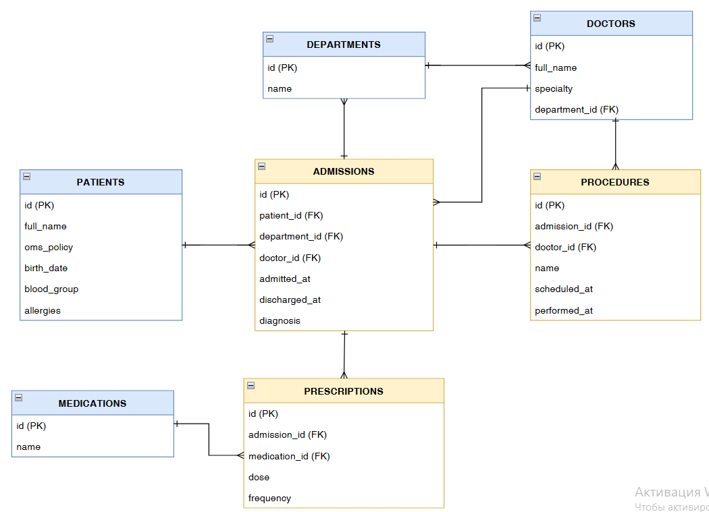
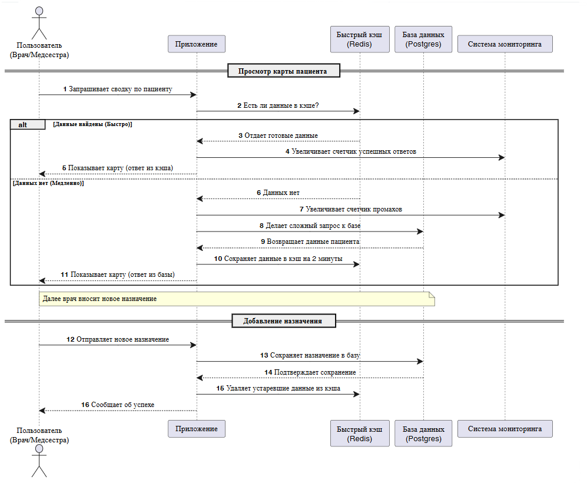
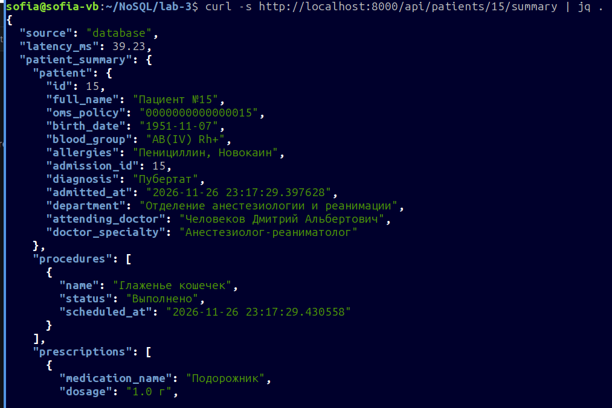
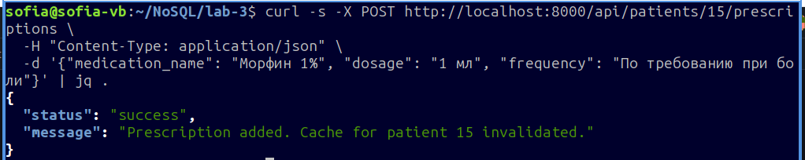
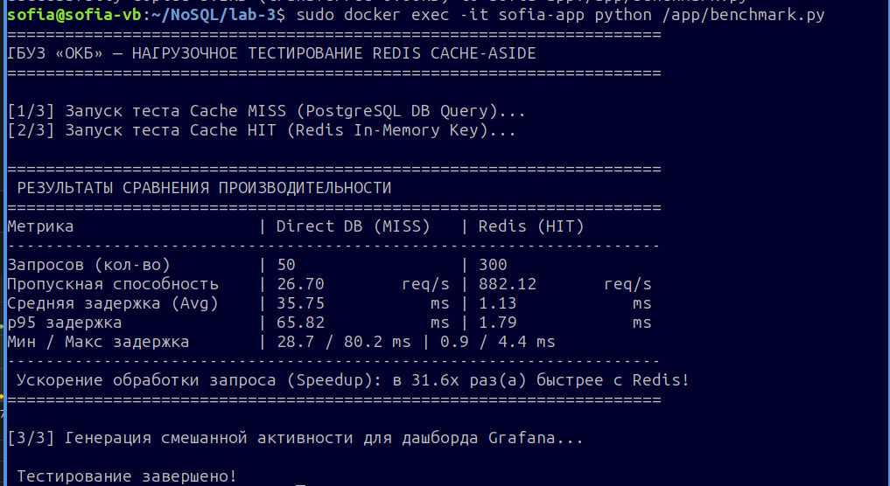
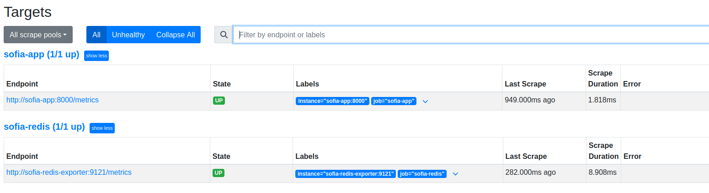
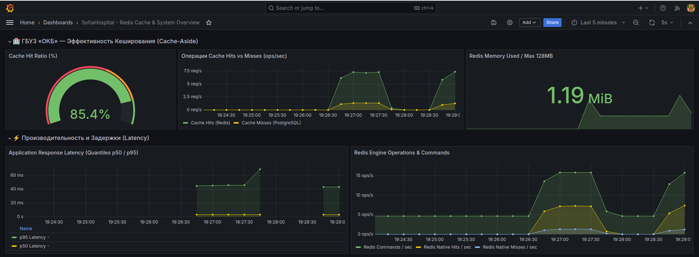

# Лабораторная работа №3. Эксплуатация Redis

* **Окружение:** Lubuntu 24.04 LTS (x86_64), Docker Compose, Redis 7.2, PostgreSQL 16, FastAPI (Python 3.11), Prometheus, Grafana

---

## 1. Выбор сценария и предметной области

**Сценарий:** №1 — Кэширование данных основной БД (паттерн *Cache-Aside*).

**Предметная область:** Медицинская информационная система (МИС) стационара ГБУЗ «Областная клиническая больница».

**Обоснование выбора:**
* В стационаре одну и ту же карту пациента могут открывать десятки раз за смену: лечащий врач на обходе, постовая медсестра перед процедурой, анестезиолог перед операцией, дежурный врач ночью.
* Для отображения сводной карты реляционной СУБД необходимо выполнить тяжелый агрегирующий запрос с `JOIN` 4–5 таблиц: пациент + лечащий врач + отделение + список процедур + текущие назначения лекарств.
* Данные меняются заметно реже, чем читаются (профиль нагрузки Read-Heavy). Для такого профиля наиболее эффективно оперативное in-memory кэширование.
* Кэш не является источником истины: при его очистке или сбое данные гарантированно восстанавливаются из PostgreSQL. Это позволяет безопасно использовать Redis как слой ускорения.

**Объект автоматизации:** Модуль оперативного доступа к сводной карте стационарного больного (`Patient Summary`).

> **Примечание о данных:** все пациенты, врачи и назначения в лабораторной работе выдуманы, совпадения с существующими людьми случайны. Реальные персональные и медицинские данные не используются.

---

## 2. Описание решаемой задачи и требования к системе

### Постановка задачи
Врачам и медсестрам необходим мгновенный доступ к сводной карте пациента. В карте агрегируются:
* персональные данные и полис ОМС;
* группа крови и аллергические реакции;
* текущее отделение и лечащий врач;
* назначенные и выполненные процедуры;
* актуальные медикаментозные назначения.

Критичные для безопасности пациента сведения (аллергии, группа крови) должны отображаться без задержек в экстренных ситуациях.

### Проблема без кэша
Формирование одной карты требует ресурсоемкого `JOIN` таблиц `patients`, `admissions`, `doctors`, `departments`, `procedures`, `prescriptions`, `medications`. При десятках одновременных запросов PostgreSQL:
* тратит ресурсы CPU и дискового I/O на повторные агрегации одних и тех же неизменных данных;
* увеличивает время отклика с единиц миллисекунд до десятков и сотен миллисекунд;
* создает риск блокировок и деградации производительности смежных модулей МИС (приемный покой, аптека, лаборатория).

### Способ решения
Внедряется слой кэширования на базе Redis по паттерну **Cache-Aside**:
1. Приложение проверяет наличие ключа в Redis (`patient:{id}:summary`).
2. При попадании (**Cache HIT**) карта мгновенно отдаётся из оперативной памяти.
3. При промахе (**Cache MISS**) карта собирается запросом из PostgreSQL, сохраняется в Redis с TTL и отдаётся клиенту.
4. При изменении данных (новое назначение врача) соответствующий ключ удаляется из Redis (**Write-Invalidation**), исключая рассинхронизацию.

### Функциональные требования

| № | Требование | Описание |
| :--- | :--- | :--- |
| **FR-1** | Получение карты пациента | `GET /api/patients/{id}/summary` возвращает сводную карту, используя кэш |
| **FR-2** | Кэширование с TTL | Карта сохраняется в Redis со временем жизни TTL = 120 секунд |
| **FR-3** | Инвалидация при записи | `POST /api/patients/{id}/prescriptions` и добавление процедур удаляют ключ `patient:{id}:summary` |
| **FR-4** | Ручной сброс кэша | `DELETE /api/patients/{id}/cache` для административного сброса |
| **FR-5** | Отказоустойчивость | При недоступности Redis сервис прозрачно обслуживает запросы напрямую из PostgreSQL без сбоев |
| **FR-6** | Индикатор источника | В JSON-ответе поле `source` явно указывает источник: `cache` или `database` |

### Нефункциональные требования

| № | Требование | Целевое значение |
| :--- | :--- | :--- |
| **NFR-1** | Задержка ответа из кэша (HIT) | < 2 мс (медиана) |
| **NFR-2** | Задержка ответа из БД (MISS) | < 100 мс |
| **NFR-3** | Доля попаданий в кэш под нагрузкой | ≥ 80 % |
| **NFR-4** | Лимит памяти Redis | `maxmemory 128mb` |
| **NFR-5** | Политика вытеснения | `allkeys-lru` (кэш эфемерный, вытеснение наименее используемых ключей безопасно) |
| **NFR-6** | Персистентность Redis | Отключена (`save ""`, `appendonly no`), чтобы медицинские сведения не оседали на незашифрованном диске |
| **NFR-7** | Аутентификация Redis | Обязательный пароль (`requirepass`) и доступ строго во внутренней сети Docker |
| **NFR-8** | Наблюдаемость | Метрики попаданий/промахов, задержек и памяти экспортируются в Prometheus и отображаются в Grafana |

### Требования к безопасности и защите ПДн
* Redis изолирован внутри контейнерной подсети `sofia-net` и защищен паролем.
* Публикация порта Redis наружу в продакшене закрыта (в учебном стенде порт доступен локально для мониторинга и отладки).
* TTL и отключение снапшотов на диск минимизируют риски утечки чувствительных медицинских данных.

---

## 3. Архитектурная схема и модель данных

#### Реляционная модель данных (PostgreSQL)
Схема базы данных включает сущности пациентов, госпитализаций, отделений, врачей, процедур и назначений:

#### Архитектурная диаграмма взаимодействия (Sequence Diagram)
Взаимодействие компонентов при чтении, промахе кэша, попадании и инвалидации:

#### Схема ключей Redis

| Ключ | Тип данных | TTL | Назначение |
| :--- | :--- | :--- | :--- |
| `patient:{id}:summary` | String (JSON) | 120 с | Агрегированная сводная карта стационарного больного |

Ключ намеренно один на пациента: при любом изменении карты достаточно одной атомарной операции `DEL`, исключая ресурсоемкий поиск по маске (`KEYS` / `SCAN`).

---

## 4. Развертывание Redis и необходимых компонентов

Система развернута в изолированной сети Docker Compose (`sofia_hospital_net`).

### Спецификация контейнеров

| Контейнер | Базовый образ | Назначение | Порт (хост) |
| :--- | :--- | :--- | :--- |
| `sofia-postgres` | `postgres:16-alpine` | Источник истины (Primary DB): карты, процедуры, назначения | 5432 (внутренний) |
| `sofia-redis` | `redis:7.2-alpine` | Кэш карт пациентов (Cache-Aside, LRU, 128MB) | 6379 |
| `sofia-redis-exporter` | `oliver006/redis_exporter` | Экспорт внутренней статистики Redis в Prometheus | 9121 |
| `sofia-app` | Python 3.11 / FastAPI | Микросервис МИС с бизнес-логикой кэширования и метриками | 8000 |
| `sofia-prometheus-lab3` | `prom/prometheus:latest` | Сбор и хранение временных рядов метрик | 9092 |
| `sofia-grafana-lab3` | `grafana/grafana:latest` | Дашборд состояния кэша и производительности | 3003 |

## 5. Реализация приложения

При первом обращении к новому пациенту ключ в Redis отсутствует: выполняется запрос в PostgreSQL с объединением таблиц, ответ отдается клиенту со статусом source: database, и формируется ключ в Redis:

При добавлении рецепта пациенту выполняется транзакция в PostgreSQL, после чего соответствующий ключ в Redis удаляется:

## 6. Нагрузочное тестирование системы

Проведен сравнительный бенчмарк прямого обращения к PostgreSQL (с регулярным сбросом кэша) против чтения из оперативного кэша Redis:

1. Direct DB: 50 запросов к PostgreSQL с объединением таблиц.
2. Redis: 300 повторных запросов к прогретому кэшу.

Для мониторинга системы в реальном времени настроен сбор метрик в Prometheus:

Метрики приложения (sofia-app:8000/metrics): cache_hits_total (счетчик попаданий в кэш Redis); cache_misses_total (счетчик промахов с уходом в PostgreSQL); request_latency_seconds(гистограмма времени обработки HTTP-запросов).

Метрики Redis (sofia-redis-exporter:9121/metrics): redis_memory_used_bytes( объем используемой оперативной памяти); redis_commands_processed_total(общее число обработанных команд); redis_keyspace_hits_total / redis_keyspace_misses_total (нативная статистика попаданий/промахов в ключи).

Оба таргета находятся в состоянии UP:

В Grafana развернут специализированный дашборд SofiaHospital - Redis Cache & System Overview со следующими панелями:

1. Cache Hit Ratio (%). Индикатор доли попаданий в кэш достиг 85.4% (в зеленой целевой зоне > 80%).
2. Операции Cache Hits vs Misses. График интенсивности запросов демонстрирует преобладание быстрых чтений из Redis над обращениями к СУБД.
3. Redis Memory Used / Max 128MB. Расход оперативной памяти составил всего 1.19 MiB, подтверждая компактность структуры хранения JSON-документов.
4. Application Response Latency (p50 / p95). Время отклика сервиса на уровне ~1 мс, в 95% случаях укладывается в пределы нормы.
5. Redis Engine Operations & Commands. Динамика операций движка Redis показывает до 15 ops/s в моменты пиковой нагрузки.

Состояние таргетов мониторинга в Prometheus (http://localhost:9092/targets):

## 7. Выводы
В ходе выполнения лабораторной работы №3:

Внедрен паттерн Cache-Aside. Спроектирована архитектура ускорения доступа к медицинским картам стационара. Использование Redis в качестве промежуточного буфера позволило разгрузить основную реляционную базу данных PostgreSQL от повторного выполнения тяжелых запросов.

Достигнуто ускорение системы. Нагрузочное тестирование показало, что время отклика при чтении из кэша сократилось, а пропускная способность сервиса выросла.

Обеспечена консистентность данных. Реализован механизм Write-Invalidation, при котором создание нового медикаментозного назначения синхронно сбрасывает устаревший ключ в Redis, исключая риск чтения неактуальных медицинских сведений медперсоналом.

Реализована политика безопасного управления памятью. Лимит maxmemory 128mb в сочетании с алгоритмом вытеснения allkeys-lru гарантирует защиту от переполнения оперативной памяти, а отключение дисковой персистентности предотвращает утечку медицинских данных через диск.

